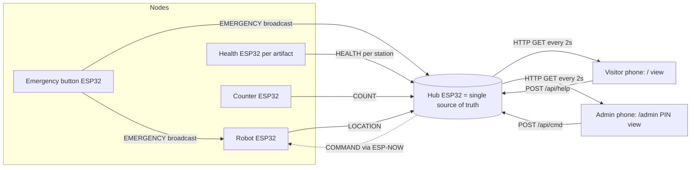

# Smart Museum Guidance System — Build Plan (WRO Future Innovators, Elementary)

**Season: WRO 2026 · Theme: "Robots Meet Culture" · Age group: Elementary (8–12, born 2014–2018)**
Regional (WROBd) → National. This is the **single canonical plan**. `CLAUDE_RECOMMENDATIONS.md`
holds the *why/decisions*; `plans/smart-museum-plan.md` is superseded.

> Theme areas for 2026 (from the Season Challenge / mission): **(1) Protecting cultural heritage,
> (2) Co-creation between humans & AI, (3) Enhancing experiences with art & history.** Our project
> targets **Area 1 + Area 3** (and the LEGO AI Guard touches Area 2).

---

## 0. Pre-flight (verified against official 2026 rules)

1. **Season = 2026, "Robots Meet Culture".** The 2025 PDFs in this folder are outdated for theme,
   age, and AI rules. Download the official 2026 docs and use them as the source of truth:
   - **2026 General Rules** (confirmed — see changes below).
   - **2026 Season Challenge (mission)** — defines the three areas above. ⬅ get this.
   - **2026 Information for Teams / Coaches.**
   - Source: [wro-association.org/competition/2026-season](https://wro-association.org/competition/2026-season/) and your National Organizer (WROBd).
2. **Rule changes 2025 → 2026** (verified from the 2026 General Rules):
   - Theme is **"Robots Meet Culture"** (was "The Future of Robots").
   - Elementary = **born 2014–2018** (was 2013–2017). Confirm every member qualifies.
   - **NEW 6.5:** the report **must disclose AI usage** (which systems, purpose, extent). Judges may ask.
   - **7.11/9.3:** certificates are Bronze (<50%), Silver (50–75%), Gold (>75%) — no "Participation" tier.
   - Scoring sheets are **unchanged** (Elementary: 200 = 70 Project/Innovation + 65 Robotic + 65 Presentation).
3. **Regional round date** from WROBd. Registration: 2000 tk (500 regional + 1500 if national). Non-refundable.
4. **Team:** 2 or 3 students. One student + coach is not a team.

---

## 1. Honest verdict on the concept

**The idea is strong — and an even better fit for 2026 than 2025.** Museum guidance hits "Robots Meet
Culture" cleanly; it's locally grounded (Bangla/English, Bangladeshi museum); the station-stop
narrative plus **per-artifact protection (temperature, humidity, gas)** is a textbook Area 1 story.
Keep the idea.

**The scope is still not an Elementary scope.** As written it spans 7+ subsystems and 11 features.
Two or three 8–12-year-olds cannot build and code all of it, and **rules 3.3/3.4 require the team to
build and code it themselves** (coach may guide, not build/code). Consequences:

- **Judges test ownership.** *Technical Understanding & Quick Thinking* (15) + *Team Spirit* (20)
  reward kids who can explain and fix their own work. Rule 7.10 lets judges deduct if the coach does it.
- **Reliability is scored.** *Demonstration* (15) requires a run that "can be repeated." Judges visit
  twice. Six features at 100% beat eleven at 70%.
- **Scoring math:** only **65 of 200** points are the Robotic Solution. Over-engineering tech fights
  for a few points inside 65 while eating the other 135 (presentation, idea, team). **Cutting scope
  *is* the winning strategy.**

**Budget:** original 33,264 tk is ~60% over. Revised BOM in §5 lands near **20,000 tk** (per-artifact
gas monitoring is kept by decision — see D4 in the recommendations log).

---

## 2. What to build (the cut list)

### BUILD — core demo, must all work every single time

| # | Feature | How |
|---|---|---|
| 1 | Guide robot follows the track | 2 motors + 5-array IR line sensor on black tape |
| 2 | Stops at each station | RC522 reads a MIFARE card taped **on top** at each station |
| 3 | Narrates in Bangla or English | DFPlayer Mini + SD, language chosen by button at start |
| 4 | Shows where it is / where it's going | OLED (station name) + WS2812 arrow |
| 5 | Stops for people | Front IR obstacle sensor → pause, resume when clear |
| 6 | Emergency mode | **Physical button** → skip stations, drive to exit; all track LEDs blink + buzzers |
| 7 | Track station lights | WS2812 at each station, lit by the robot over ESP-NOW |
| 8 | **Artifact health — every artifact** | DHT11 + **MQ-135 gas** at each station → reported **per-station** to admin, with green/yellow/red thresholds so any change triggers an alert *(Area 1 story)* |
| 9 | Visitor counting | IR beam at the gate → count at gate + on dashboard |
| 10 | Dashboard web app | Hub ESP32 serves a local page; QR opens it. Visitor view + PIN-gated admin view |
| 11 | Queue instruction | Pure audio/LED logic on the robot — free feature |

### STRETCH — only after 1–11 run reliably three times in a row

| Feature | Note |
|---|---|
| ESP32-CAM photo at each station | Serve the last photo from the CAM's own local web server. **Do not** attempt cloud upload. |
| Restricted-area gate | Second RC522 + staff card → buzzer if unauthorised |

### DROP

| Feature | Why |
|---|---|
| Face recognition **inside the main system** | Runs standalone on the AI Guard (D1). No ESP-NOW link — the feature survives, the complexity doesn't |
| Bangla alphabet teaching | Separate module, not in the core story; doc already marks it optional |
| Firebase (RTDB + Storage) | Venue WiFi is the #1 demo-day killer — ESP-NOW + SoftAP replaces it |
| 3D-printed chassis (3000 tk) | Cut PVC board. Faster to iterate, kids can do it themselves |

**Kept but separate:** the LEGO AI Guard runs on its own at the booth (D1), shown after the main
5-minute demo. The confidence display lives on the Guard itself.

---

## 3. Architecture — fully offline (ESP-NOW + SoftAP)

No venue WiFi, no internet, no cloud in the critical path.

```
                ESP-NOW (no router/internet, fixed channel 1)
    ┌──────────────┬──────────────┬──────────────┐
    │              │              │              │
[Robot ESP32]  [Track ESP32]  [Health ESP32]  [Gate/Hub ESP32]
 line follow    WS2812 ×N      DHT11 + MQ-135   IR counter
 RC522          buzzers         at each artifact SoftAP + web page
 DFPlayer       (blink on EMG)  per-station       ↑
 OLED, IR                        ↑                │  phones join this AP
 arrow LEDs                 [ QR code at the gate → http://192.168.4.1 ]
```

- **ESP-NOW** for board-to-board messages: ~5 lines to send, no credentials, no internet. Satisfies
  rule 5.1.3's preference for devices that communicate.
- **One Hub ESP32 (the gate)** runs SoftAP "MuseumBot" on **channel 1** + the web page; visitors scan
  a QR and land on `192.168.4.1`.
- **The gotcha that costs an evening:** ESP-NOW and SoftAP on the *same* board must use the **same
  WiFi channel**. Pin the Hub to channel 1 and set every other board to channel 1 explicitly.
- **Emergency is a broadcast** (`FF:FF:FF:FF:FF:FF`) so every node reacts even if the Hub reboots.

### 3.1 Visitor ↔ Admin web app — data flow (the question you asked)

One web app, **two views** (routes) of **one source of truth** (the Hub). Both phones join the same
"MuseumBot" WiFi; what differs is which page each device loads and whether a PIN is entered.



**Step by step:**
1. **Entry.** Visitor scans the QR at the gate. The QR encodes the WiFi join
   (`WIFI:T:WPA;S:MuseumBot;P:...;;`) so the phone connects, then a **captive portal** auto-opens
   `http://192.168.4.1/`. (Simplest fallback: QR = the URL and they join WiFi manually.)
2. **Visitor view (`/`).** Read-only, auto-refresh ~2 s: language toggle **বাংলা/English** (Bengali
   renders natively in the phone browser — no font work), museum map, robot's current station + what
   it's narrating (text), next station, queue/wait prompts, and an emergency banner when active.
3. **Admin view (`/admin` or PIN on the visitor page).** Auto-refresh ~2 s: live visitor count, robot
   status/location, **per-artifact health table** (each station: temp, humidity, gas, status
   green/yellow/red, last-seen), images (if ESP32-CAM), device online/offline, restricted-area
   attempts, and emergency reset.
4. **How a visitor event reaches the admin device.** Visitor taps e.g. "I need help" → small HTTP
   `POST /api/help` to the Hub → Hub stores it → admin's next refresh shows it. The Hub is the bridge
   between the two devices; they never talk to each other directly.
5. **How an admin action reaches the nodes.** Admin taps "reset emergency" / "acknowledge alert" →
   `POST /api/cmd` to the Hub → Hub broadcasts a `COMMAND` over ESP-NOW to the relevant node(s).
   (Note: emergency is **triggered** by the physical button for autonomy; admin "reset" is convenience.)
6. **Realtime, kid-style.** Auto-refresh every 2 s via `<meta http-equiv="refresh">` or a tiny
   `fetch()` — no WebSockets. Both views read the same in-RAM state on the Hub.

**Why this is defensible as the kids' own work:** it's plain HTML + a little JS, served from an
ESP32, no build tools, no cloud. A 10–12-year-old can write and explain it.

---

### 3.2 Who hosts what — the bridge rule (locked)

**One node hosts the web pages: the dedicated Hub/Gateway ESP32 at the gate. Every other device is
either an ESP-NOW node or a browser client.** This is what keeps each node's primary job uninterrupted.

| Device | Primary job | Hosts web pages? |
|---|---|---|
| Robot ESP32 | drive, RFID, audio; broadcasts LOCATION | No — too time-critical |
| Track ESP32 | station LEDs + buzzer; listens | No |
| Health ESP32 | DHT11 + MQ-135 per artifact; broadcasts HEALTH | No |
| Emergency-button ESP32 | physical button; broadcasts EMERGENCY | No |
| ESP32-CAM | capture photo; **HTTP-uploads** one image to Hub | No (it is a client) |
| **Hub/Gateway ESP32** | **SoftAP "MuseumHub" (ch1) + web server + ESP-NOW aggregator** | **YES — the only host** |
| Visitor phone | browser | Client — opens `/` |
| Admin laptop | browser | Client — opens `/admin.html` |

**Bridge rule:** nothing on a phone/laptop talks directly to a node. All data flows
`node →ESP-NOW→ Hub →HTTP→ screen`, and commands flow back `screen →HTTP→ Hub →ESP-NOW→ node`.
Only the Hub serves WiFi/HTTP; every other node only sends/receives tiny ESP-NOW packets (the CAM
does one HTTP upload as a client). Net effect: the dashboard cannot stutter the motors, glitch the
LEDs, or stall the camera.

> Reliability note: an all-ESP32 offline AP is far more reliable than venue WiFi. For *maximum*
> reliability keep the Hub dedicated (do not fold the host role onto the robot/CAM/track). If a board
> must be saved, the track ESP *can* double as host, but it is the weaker choice.

## 4. Hardware decisions that will bite you

- **Bangla never goes on the TFT.** (D3.) Bengali needs conjunct/matra shaping no Arduino library
  does. The **TFT shows English only**. Bangla lives on the speaker (kids' recordings), printed
  labels, and — the useful part — **the phone dashboard, where the browser shapes Bengali for free.**
- **Use `Adafruit_ILI9341`, not `TFT_eSPI`.** TFT_eSPI needs hand-edited `User_Setup.h` inside the
  library — breaks on updates, hard for a child to debug. Adafruit's takes pin numbers as arguments.
  ILI9341 and ESP32 are both 3.3 V → no level shifter. Budget 50–100 mA for backlight.
- **Two drive motors, not four.** 4-wheel differential scrubs on turns and worsens line following.
  2 motors + 1 caster: simpler code, better tracking, saves ~1900 tk.
- **Brownout is the classic failure.** ESP32 resets when motors kick in. Use a **separate LM2596 for
  logic** and another for motors, + 1000 µF across the motor-driver input. Most common "worked at
  home, died at the venue" cause.
- **RFID tags go on top of the track, not under it.** RC522 range is ~2–3 cm. Tape MIFARE cards to
  the surface, thin sticker on top. Test the read at the robot's real speed — slow before stations.
- **You don't need the LM386.** DFPlayer Mini has a built-in 3 W amp on its SPK pins that drives an
  8 Ω speaker directly.
- **DFPlayer SD card:** **8 or 16 GB**, FAT32, files as `0001.mp3` in an `/mp3` folder. 32 GB is a
  coin flip. Put a **1 kΩ resistor in series on RX** or you get audible noise.
- **RC522 is 3.3 V.** Never feed it 5 V.
- **MQ-135 (kept per artifact) — know its limits:**
  - **Burn-in:** needs 24–48 h powered on before readings stabilise. Power them on early at home.
  - **Heater current:** ~150 mA **each**, continuous. 3 sensors ≈ 450 mA → give them their **own
    buck rail**, do not share with the ESP32 logic rail.
  - **Relative, not absolute:** output is a rough air-quality trend, not calibrated ppm. Present it
    as "pollution/gas level vs our threshold → green/yellow/red." The story (gases + humidity damage
    artifacts) is what scores, not the exact number.
  - ADC: ESP32 ADC1 (GPIO32–39) for analog gas readings; keep WiFi off ADC2 pins.
- **LiPo safety.** 3S LiPo with children → adult-owned charging routine: LiPo bag, never unattended,
  main power switch + inline fuse on the robot.

---

## 5. Revised BOM (≈ 20,000 tk)

| Item | Qty | Unit | Total | Note |
|---|---|---|---|---|
| ESP32 devkit | 5 | 450 | 2250 | robot, track, health, hub + 1 spare |
| ESP32-CAM | 1 | 940 | 940 | stretch |
| 5-array line sensor | 2 | 310 | 620 | |
| RC522 reader | 2 | 190 | 380 | |
| MIFARE cards | 7 | 32 | 224 | |
| IR sensor module | 4 | 40 | 160 | obstacle + counter + spares |
| DHT11 | 3 | 120 | 360 | **one per artifact** |
| **MQ-135 gas sensor** | **3** | **150** | **450** | **kept per artifact (D4)** |
| WS2812 8-bit stick | 4 | 150 | 600 | |
| DFPlayer Mini | 2 | 250 | 500 | |
| Speaker 3 W 8 Ω | 2 | 200 | 400 | |
| microSD 16 GB | 2 | 500 | 1000 | not 32 GB |
| 3.2" TFT ILI9341 SPI | 1 | 1810 | 1810 | kept (D3), English only — likely at the gate (Q2) |
| 0.96" OLED SSD1306 | 2 | 350 | 700 | robot station names |
| 12 V 25G motor | 2 | 660 | 1320 | 2 not 4 |
| Wheel + caster | 2+1 | — | ~900 | |
| Clamp / coupler | 2+2 | 100 | 400 | |
| L298N driver | 1 | 145 | 145 | |
| LM2596 buck | 3 | 245 | 735 | separate logic/motor/gas rails |
| 3S LiPo + B3 charger | 1+1 | — | 2210 | |
| Buzzer | 4 | 15 | 60 | |
| Push button / switch | 4+3 | — | 240 | incl. emergency button |
| Breadboard + jumpers + wire | — | — | 1500 | |
| Transistors, resistors, caps | — | — | 250 | incl. DFPlayer RX resistor |
| PVC board 5 mm | 1 | 1400 | 1400 | not 3D print |
| Art paper, print, glue, zip tie | — | — | 900 | |
| **Total** | | | **≈ 20,000** | **from 33,264** |

*Not included:* the LEGO AI Guard kit (already owned/sourced separately, D1).
Per-artifact gas monitoring adds back ~1,000 tk vs the earlier cut — a deliberate, defensible choice
(stronger Area 1 "protecting heritage" story).

---

## 6. Build order (robot-first; ESP-NOW folds in at the track phase)

Anchor to the WROBd regional date. Nothing in a later phase starts until the previous phase runs
**three times in a row without a human touching it.** Every phase ships with a **wiring guide**.

- **Phase 0 — Web app (team decision: build first).** Visitor + admin dashboards; the **7 Bangladeshi
  artifact exhibits** (Jamdani, Nakshi Kantha, Liberation War, Terracotta, Ektara, Palki, Royal Bengal
  Tiger); **QR check-in → admin approval → dashboard unlock** flow. Static HTML/CSS/JS now with a mock
  Hub (`localStorage`); live robot/per-artifact-health data is wired in at Phase 4/6. QR decode is
  offline (`jsQR`) via a camera-capture input so it works over the ESP32's HTTP. *Exit: full check-in →
  approve → visitor dashboard flow runs in a browser; both languages; admin sees count + health.*
- **Phase 1 — Robot moves.** Chassis, 2 motors, L298N, power rails, line-follow on a taped oval.
  *Exit: 5 laps unattended.*
- **Phase 2 — Robot knows where it is.** RC522 + cards at 3 stations, stop, OLED shows station name,
  continue. *Exit: correct station every lap, 3 laps.*
- **Phase 3 — Robot talks.** DFPlayer, kids record Bangla + English, language button, queue line,
  arrow LEDs. *Exit: both languages, 3 laps.*
- **Phase 4 — Track responds (+ ESP-NOW foundation).** Track ESP32 + WS2812 per station; ESP-NOW
  from robot. Pin channel 1 on all boards. *Exit: right LED, right moment, 3 laps.*
- **Phase 5 — Emergency.** Physical button → skip stations, drive to exit, all LEDs blink, buzzers.
  *Exit: triggered from any point on the track.*
- **Phase 6 — Artifact health + gate + dashboard.** Health ESP32 (DHT11 + MQ-135 per artifact),
  per-station thresholds → alert; IR visitor counter; Hub SoftAP + HTML page + QR + captive portal.
  *Exit: phone sees live per-station data, twice; one crossed threshold turns a station red.*
- **Phase 7 — Freeze the build.** No new features. Report, booth, slogan, rehearsal.
- **Phase 8 — Rehearse.** Full 5-minute run, ten times, different kids leading. Spares box + printed
  wiring diagram.

Rule: **Phase 7 starts no later than three weeks before the event.**

---

## 7. Cheap points the concept doc is missing (~45 pts, little build time)

- **"Usage of the idea" — 15 pts.** Talk to **at least two non-family people** about the idea. Take
  the kids to a museum; interview a guide and a visitor; photograph and quote it in the report/booth.
- **"Key Innovation & Slogan" — 10 pts.** No slogan exists yet. One memorable line, Bangla + English,
  printed large on the booth.
- **"Team Spirit" — 20 pts.** Matching shirts, a named role each (driver/coder/presenter), every
  member speaks during the 5 min, and the **kids** — not the coach — fix problems at the booth.
- **Report.** Mandatory, PDF ≤ 20 pp, ≤ 15 MB. Elementary: ≤ 15 pp robotic solution, ≤ 3 pp social
  impact. **Bring 2 printed copies.** Longer = zero. **NEW 2026: disclose AI usage** (which systems,
  purpose, extent) — be honest about the AI Guard and any tools used.
- **Video.** 90 s; mandatory only for the International Final — but make one for the booth screen.

---

## 8. Demo-day risk list

| Risk | Mitigation |
|---|---|
| Wrong season docs | Use the **2026** General Rules + Season Challenge + Info for Teams (§0) |
| Member born outside 2014–2018 | Confirm eligibility now |
| Venue WiFi unusable | Already handled: ESP-NOW + SoftAP, no internet in the critical path |
| Hall lighting breaks line following | Shroud the sensor array; recalibrate on site; calibration button |
| Motor brownout resets ESP32 | Separate logic buck + bulk capacitor |
| RFID missed at speed | Slow before stations; retry read; station-count fallback in software |
| MQ-135 reads noise / no burn-in | Power on 24–48 h early; show trend vs threshold, not ppm; own buck rail |
| Battery dies mid-judging | Two charged packs, swap between rounds |
| A wire breaks | Spares box: pre-made jumpers, a spare of each sensor, screwdriver, tape, glue gun |
| Limited power sockets (BD rulebook) | Bring your own multiplug |

---

## 9. What to tell the team on day one

Build **one robot that does six things perfectly**, explained by a ten-year-old, on a track that
lights up, **with every artifact watched for temperature, humidity and gas**, and a phone page
anyone opens by scanning a QR — then spend the saved time on the museum visit, the slogan, the booth,
AI disclosure, and rehearsing the five minutes. That scores better than eleven half-working features,
and it's the version the kids can honestly say they built themselves.
