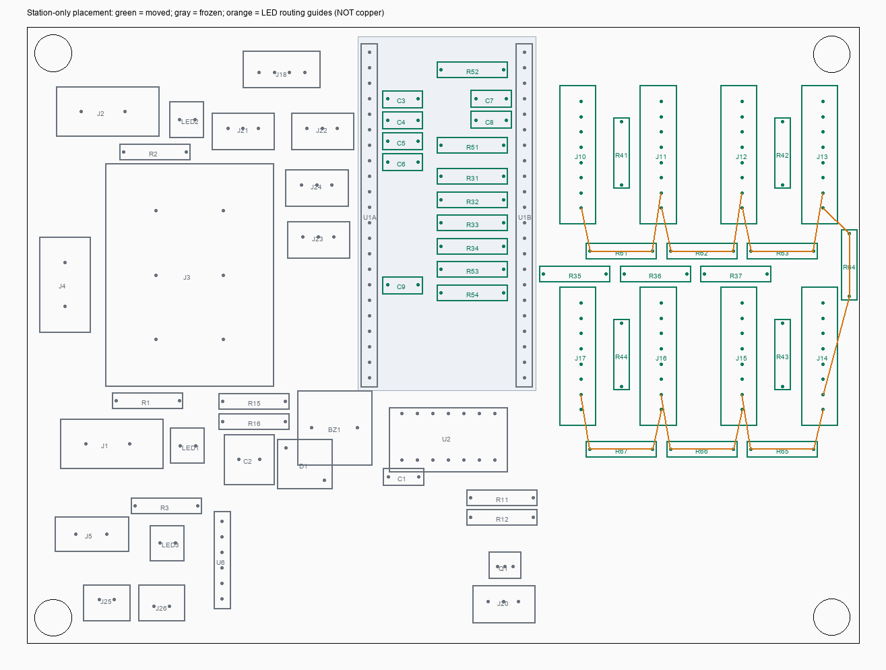

# H-003 — Station-only placement, 2026-10-27

## Saved result

Only the 37 station-group parts that were outside the board were placed:
J10–J17, R31–R37, C3–C9, R41–R44, R51–R54, R61–R67.
All other 40 components and their current user-edited placements are preserved.

- S1, S2, S3, S4: left-to-right across the upper row (connector centres y3150 mil).
- S5, S6, S7, S8: right-to-left across the lower row (centres y1850 mil).
- All eight ports vertical, with 520 mil column spacing. Seven LED hop resistors sit along the
  row edges/turn, allowing short local connections without a long cross-board chain return.
- MQ filter capacitors are low parts under the socketed DevKit, near the actual matching ADC pins;
  signal-pad distance is below 275 mil (7 mm). This is preferable to putting the filter at the far port.
- Zone pull-ups sit in connector column gaps; zone series resistors are near their MCU inputs.
- No routing was created, changed or removed.

## Hard verification

- Full archive inspection: exactly 37 COMPONENT pose changes and 91 component-owned ATTR transforms;
  no added/deleted record and no other PCB-record change. Unrelated placements, free silk, nets,
  all pad-net mappings, all footprint/library documents and the schematic are unchanged.
- All 50 existing routed copper segments, holes and outline are byte-identical to the guarded backup.
- Live pad transformations and actual footprint-body bounds agree with the offline model.
- Placement model: zero new target/fixed-body/edge/hole collisions (20 mil body spacing, 10 mil edge,
  40 mil from mounting-pad rings). The model does not claim an autorouted solution or certify fabrication.
- Strict DRC unchanged: **25 Physical Error + 234 Connection Error**, no new finding.
- Eight routing-oriented placement regression tests passed before writing; full-export acceptance gate
  was observed failing on the unplaced board and passing after the move.
- Final regression discovery passed all 22 model tests (8 new placement + 7 existing hub + 7 station).
  The 13 historical SB acceptance checks intentionally skip generic discovery because they require
  explicit historical archive inputs; the new placement export acceptance was run directly and passed.

## Backups and evidence

- Original pre-plan archive: [WRO_HUB_before_station_place_20261027-0128.epro2](WRO_HUB_before_station_place_20261027-0128.epro2).
- **Authoritative before-write backup:** [WRO_HUB_before_station_place_guard_20261027-0148.epro2](WRO_HUB_before_station_place_guard_20261027-0148.epro2).
- **Saved placed project:** [WRO_HUB_after_station_place_20261027-0148.epro2](WRO_HUB_after_station_place_20261027-0148.epro2).
- Evidence: `../scripts/hub/data/station_place_20261027/`, including before/after inventories and live DRC,
  placement plan/preview, write result, exact export acceptance and verification summary.
- Model/test/writer/acceptance: `station_placement.py`, `test_station_placement.py`, `59_place_station.js`,
  `verify_station_placement.py` in `../scripts/hub/`.

The first write attempt aborted before any move because BZ1, D1 and five servo resistors had changed while
the plan was being prepared. Those concurrent edits were preserved in a fresh checkpoint and the model
was rerun; the final comparison uses that immediate before-write state, not the stale initial snapshot.

## Scope cautions and review

Unrelated off-board parts (including R4, R6 and R13, plus user-moved servo resistors) were deliberately not
placed. All free station names/pin labels remain at their previous off-board positions; they were not moved,
deleted or regenerated because the user limited this task to parts. Component-owned attributes followed
their parts. A dedicated station-label cleanup remains necessary before fabrication.

Separate author self-review of the scope, frozen-state guard, body/pad model, export-diff gate and DRC result;
not an independent engineering review. Existing J3 binding/XT-hole and remaining DRC issues are outside scope.
Do not run old placement/schematic/silk builders over this manual layout. No commit, push or order was made.
